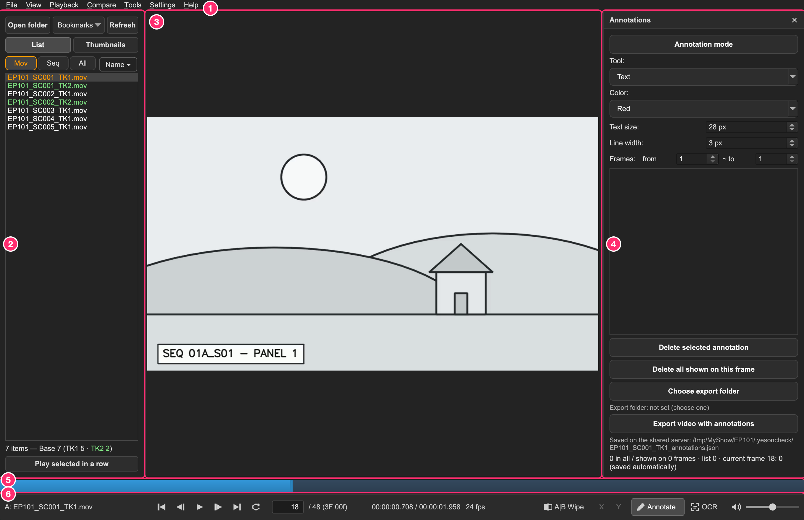
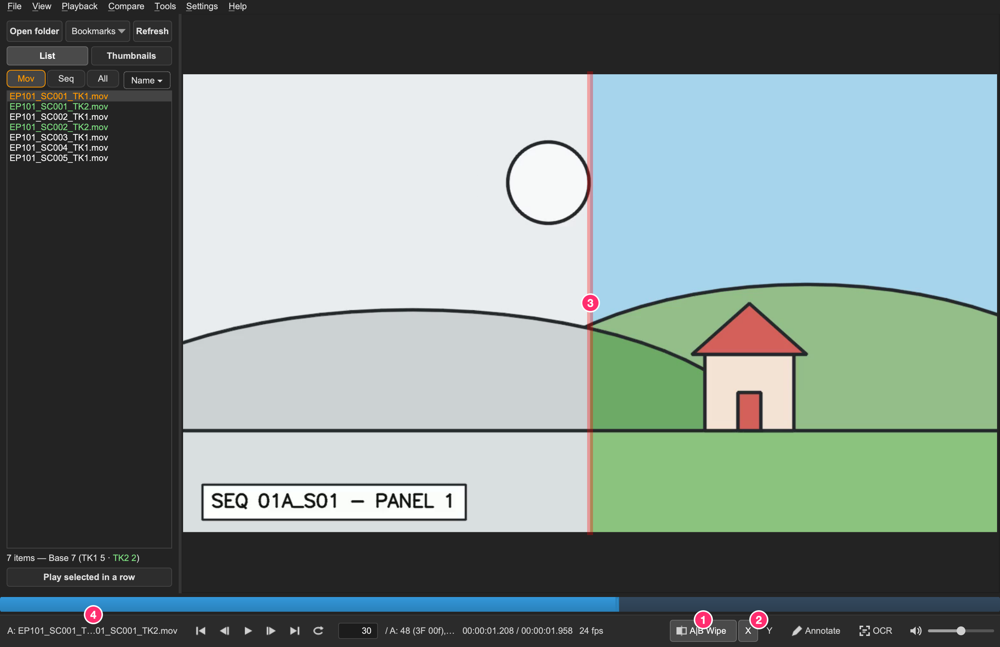
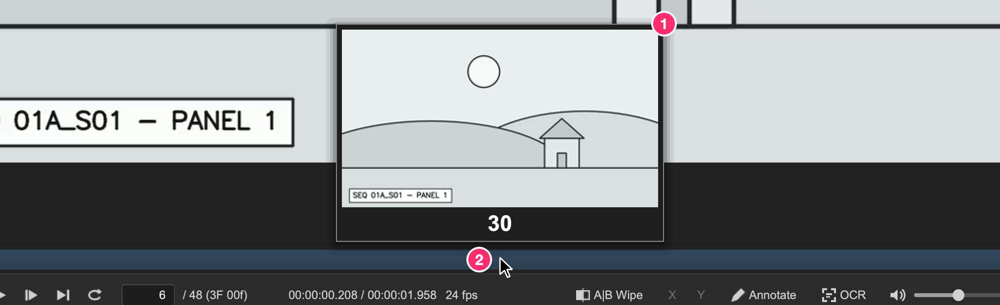
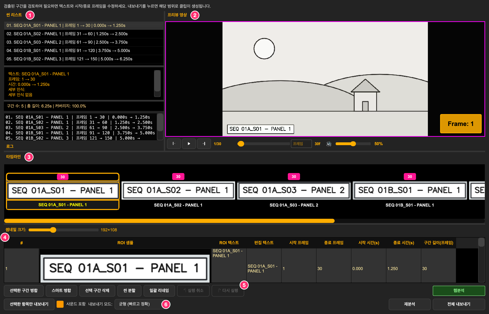

# YesonCheck

[한국어](README.md) | **English** | [Español](README.es.md) | [简体中文](README.zh-CN.md) | [日本語](README.ja.md)

YesonCheck is a video player for reviewing animation production work (PyQt5). In one window it plays videos and image sequences frame by frame, compares two videos by laying one over the other (A/B wipe), keeps revision notes on frames, and splits animatics into segments with OCR and cut detection so they can be exported as clips. It runs on Mac (Intel and Apple Silicon) and Windows, and the main window can be shown in Korean or English.

## Screenshots
All pictures were taken with synthetic video and made-up file names. They are the same pictures as the in-app user guide, where the numbered badges are explained.

**Main window** — video list in the sidebar on the left, the video in the middle, the tool panel (revision notes) on the right, the playback bar at the bottom

**A/B wipe** — lay two videos over each other and move the line to compare them

**Slider preview** — hover over the time slider to see the picture and number of the frame at that point

**OCR review window** — correct the segments found from on-screen text and export them as clips (this window is shown in Korean)

## Main features
- **Frame-accurate playback** of videos and image sequences (tga, png, exr …), with a playback bar that always stays in the same place: go to start or end, step one frame, loop, and type a frame number to jump to it
- **A/B comparison** with a left/right or top/bottom wipe
- **Revision notes**: text and shapes on each frame, saved automatically, and export a video with the notes burned in
- **OCR and cut detection** (PySceneDetect, TransNetV2) to split animatics into segments — review, merge, split and rename them, then export clips
- **Fast ProRes playback**: on Mac with the system decoder (VideoToolbox), on Windows with the bundled ffmpeg
- **Sidebar**: video list with thumbnails, sorting, counts and bookmarks; previews on the time slider
- **Updates**: a banner tells you when a new version is out, and one click installs it
- **Screen language**: Korean or English in Settings → 언어 (Language) — secondary windows and error messages are still in Korean

## Download and install
Get the latest version from [Releases](https://github.com/yesonsys03-web/yesoncheck/releases/latest):

| Computer | File |
|---|---|
| Windows | `YesonCheck_Setup_<version>.exe` |
| Mac (Apple Silicon) | `YesonCheck_Autocut_AppleSilicon_<version>.dmg` |
| Mac (Intel) | `YesonCheck_Autocut_Intel_<version>.dmg` |

- The Mac app needs macOS 12.3 or later.
- On Windows, sound needs the [K-Lite Codec Pack](https://codecguide.com/download_kl.htm) (the Basic edition is enough). Without it the picture plays but there is no sound.

## User guide
In the app, **Help → User guide (F1)** opens the user guide in your browser — a page for each feature with pictures, the keyboard shortcuts and the release notes, in Korean or English.

## For developers
Running from source, building and the code structure are described in the Korean [README](README.md) and [BUILD.md](BUILD.md) (both in Korean).

## License
YesonCheck is released under the GNU General Public License v3.0 (**GPL-3.0**) — see [LICENSE](LICENSE). The licenses and sources of the bundled third-party components are listed in [THIRD_PARTY_NOTICES.md](THIRD_PARTY_NOTICES.md).
