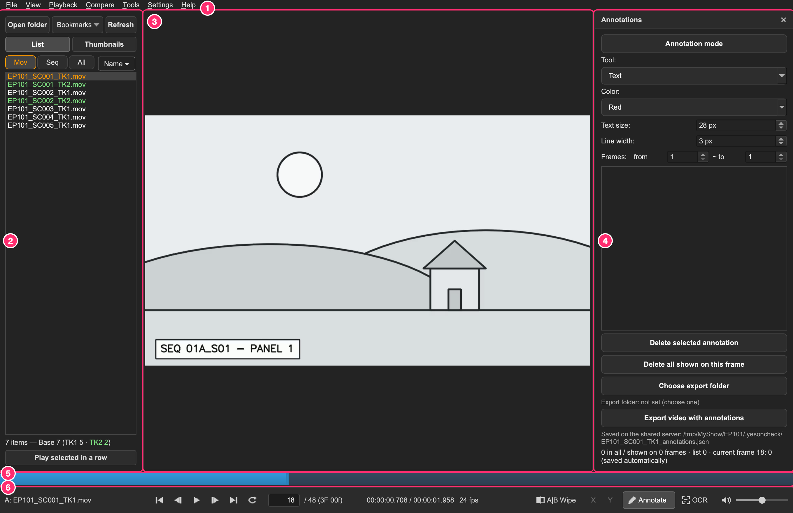
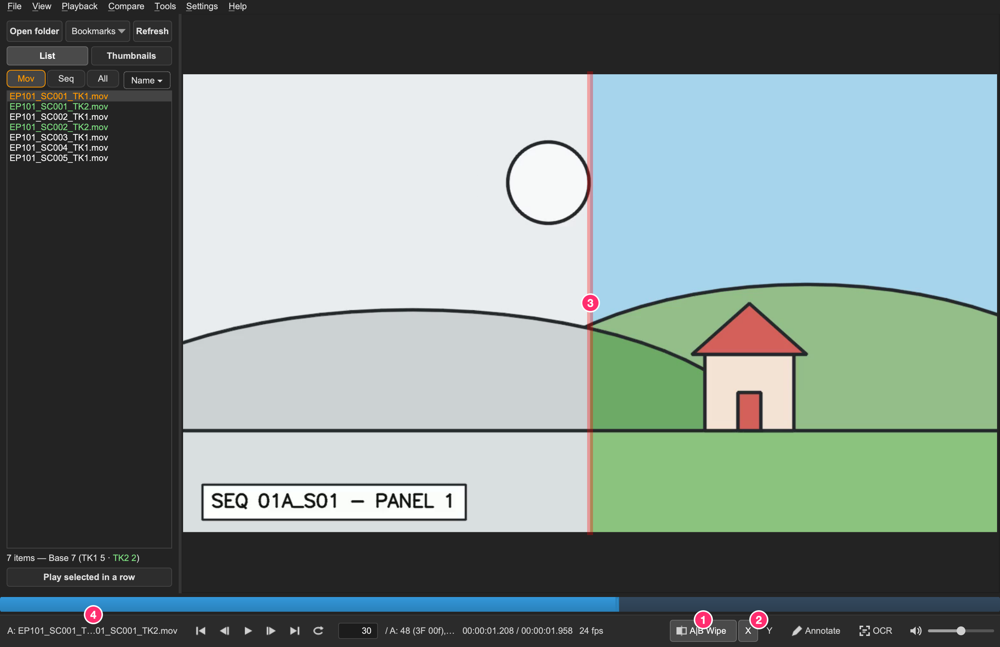
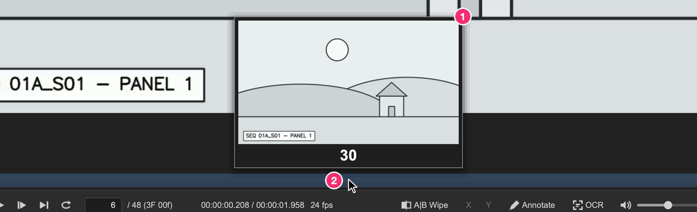
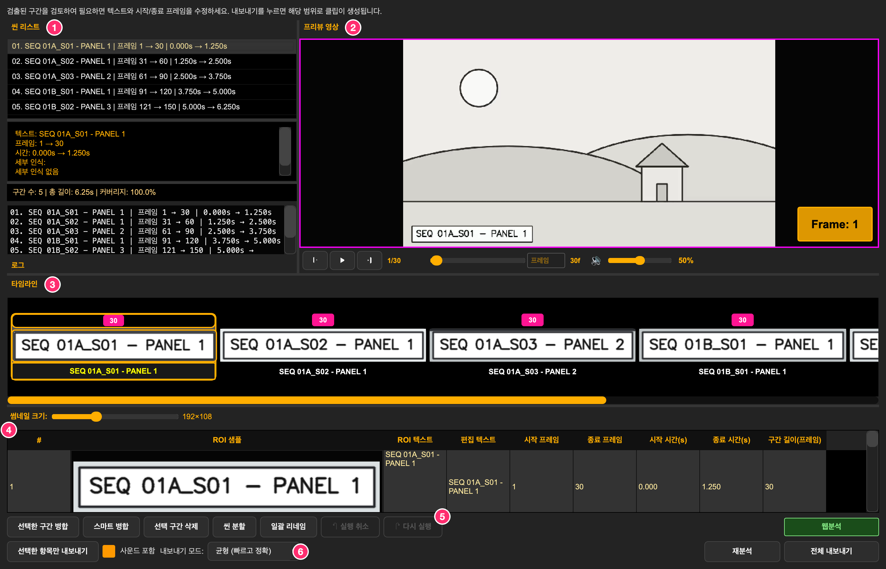

# YesonCheck

[한국어](README.md) | [English](README.en.md) | **Español** | [简体中文](README.zh-CN.md) | [日本語](README.ja.md)

YesonCheck es un reproductor de vídeo para revisar trabajos de producción de animación (PyQt5). En una sola ventana reproduce vídeos y secuencias de imágenes fotograma a fotograma, compara dos vídeos superponiéndolos (cortinilla A/B), guarda notas de corrección sobre los fotogramas y divide animáticas en segmentos mediante OCR y detección de cortes para exportarlos como clips. Funciona en Mac (Intel y Apple Silicon) y en Windows, y la ventana principal puede mostrarse en coreano o en inglés.

## Capturas de pantalla
Todas las imágenes se tomaron con vídeo sintético y nombres de archivo inventados. Son las mismas imágenes que la guía de uso integrada en la aplicación, donde se explican los números.

**Ventana principal** — lista de vídeos en la barra lateral a la izquierda, el vídeo en el centro, el panel de herramientas (notas de corrección) a la derecha y la barra de reproducción abajo

**Cortinilla A/B** — superpone dos vídeos y mueve la línea para compararlos

**Vista previa en el control deslizante** — al pasar el ratón sobre el control de tiempo se ven la imagen y el número del fotograma en ese punto

**Ventana de revisión OCR** — corrige los segmentos encontrados a partir del texto en pantalla y expórtalos como clips (esta ventana se muestra en coreano)

## Funciones principales
- **Reproducción precisa fotograma a fotograma** de vídeos y secuencias de imágenes (tga, png, exr …), con una barra de reproducción que siempre está en el mismo sitio: ir al inicio o al final, avanzar o retroceder un fotograma, repetir y escribir un número de fotograma para saltar a él
- **Comparación A/B** con cortinilla izquierda/derecha o arriba/abajo — pasa el ratón por una fila de la lista y pulsa **B** para abrirla en B con la cortinilla activada
- **Notas de corrección**: texto y formas en cada fotograma, guardadas automáticamente, y exportación de un vídeo con las notas incrustadas
- **OCR y detección de cortes** (PySceneDetect, TransNetV2) para dividir animáticas en segmentos — revisarlos, unirlos, dividirlos y renombrarlos, y después exportar los clips
- **Reproducción rápida de ProRes**: en Mac con el decodificador del sistema (VideoToolbox) y en Windows con el ffmpeg incluido
- **Barra lateral**: lista de vídeos con miniaturas, ordenación, recuentos y marcadores; vistas previas en el control de tiempo
- **Actualizaciones**: un aviso indica cuándo hay una versión nueva y se instala con un clic
- **Idioma de la pantalla**: coreano o inglés en Settings → 언어 (Language) — las ventanas secundarias y los mensajes de error siguen en coreano

## Descarga e instalación
Descarga la última versión desde [Releases](https://github.com/yesonsys03-web/yesoncheck/releases/latest):

| Equipo | Archivo |
|---|---|
| Windows | `YesonCheck_Setup_<versión>.exe` |
| Mac (Apple Silicon) | `YesonCheck_Autocut_AppleSilicon_<versión>.dmg` |
| Mac (Intel) | `YesonCheck_Autocut_Intel_<versión>.dmg` |

- La aplicación para Mac necesita macOS 12.3 o posterior.
- En Windows, el sonido necesita [K-Lite Codec Pack](https://codecguide.com/download_kl.htm) (basta con la edición Basic). Sin él se ve la imagen, pero no se oye el sonido.

## Guía de uso
En la aplicación, **Help → User guide (F1)** abre la guía de uso en el navegador: una página por función con imágenes, los atajos de teclado y las notas de versión, en coreano o en inglés.

## Para desarrolladores
La ejecución desde el código fuente, la compilación y la estructura del código se describen en el [README](README.md) en coreano y en [BUILD.md](BUILD.md) (ambos en coreano).

## Licencia
YesonCheck se distribuye bajo la Licencia Pública General de GNU, versión 3 (**GPL-3.0**) — consulta [LICENSE](LICENSE). Las licencias y las fuentes de los componentes de terceros incluidos figuran en [THIRD_PARTY_NOTICES.md](THIRD_PARTY_NOTICES.md).
