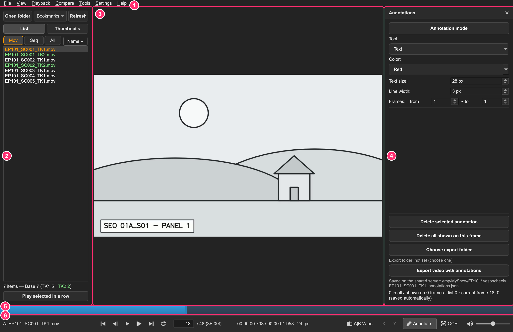
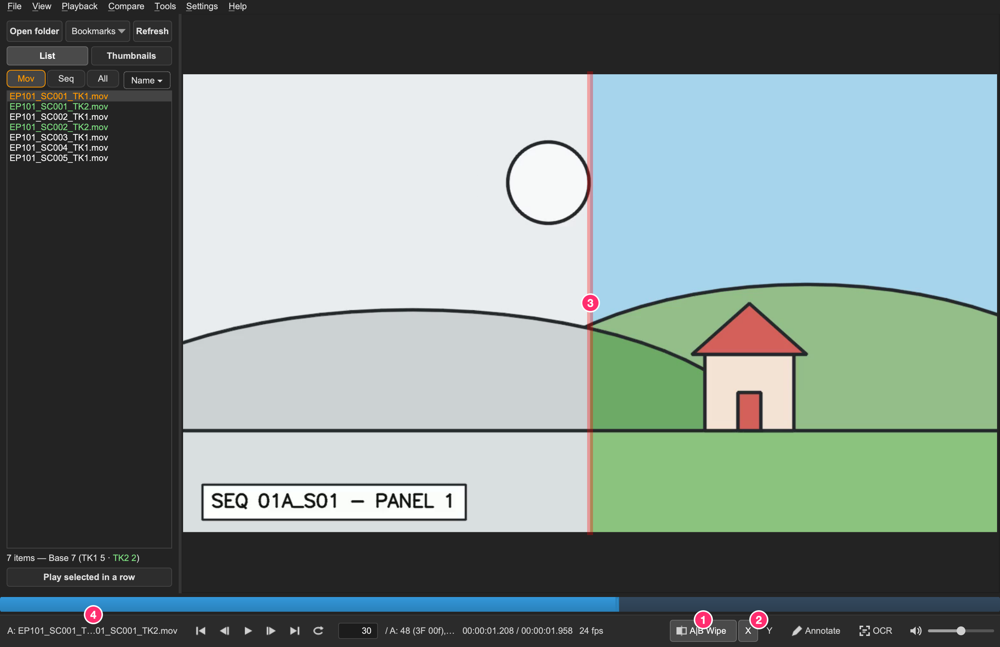
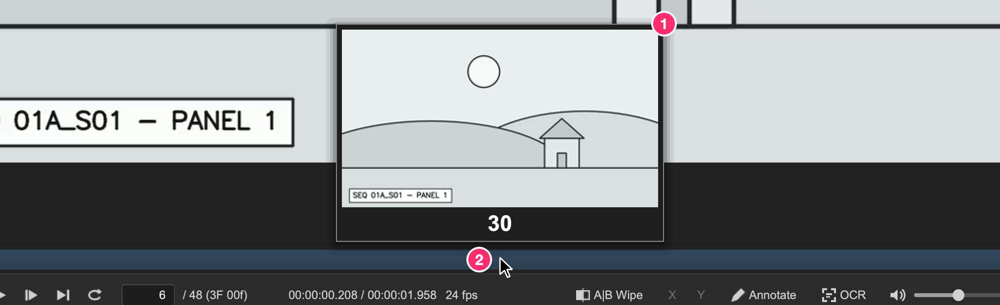
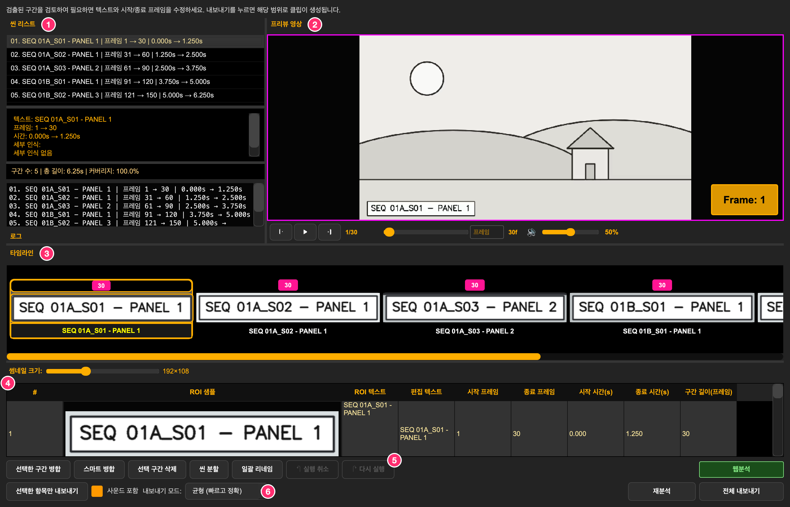

# YesonCheck

[한국어](README.md) | [English](README.en.md) | [Español](README.es.md) | [简体中文](README.zh-CN.md) | **日本語**

YesonCheck は、アニメーション制作物のチェック（検品）のための動画プレーヤーです（PyQt5）。動画と連番画像をコマ単位で再生し、2 本の動画を重ねて比較し（A/B ワイプ）、フレームに修正指示のメモを残し、OCR とカット検出でアニマティクスを区間に分けてクリップとして書き出す作業を、ひとつのウィンドウで行えます。Mac（Intel・Apple Silicon）と Windows で動作し、メインウィンドウの表示は韓国語／英語から選べます。

## スクリーンショット
画像はすべて合成した動画と架空のファイル名で撮影したものです。アプリ内の使い方マニュアルと同じ画像で、番号の意味はマニュアルで説明しています。

**メインウィンドウ** — 左のサイドバーに動画リスト、中央に動画、右にツールパネル（修正メモ）、下に再生バー

**A/B ワイプ** — 2 本の動画を重ね、境界線を動かして比較

**スライダーのプレビュー** — タイムスライダーにマウスを乗せると、その位置のフレームの画像と番号が表示されます

**OCR 確認ウィンドウ** — 画面の文字から見つけた区間を修正し、クリップとして書き出し（このウィンドウは韓国語で表示されます）

## 主な機能
- 動画と連番画像（tga・png・exr など）の**コマ単位で正確な再生** — 再生バーは常に同じ位置にあり、先頭・末尾へ移動、1 コマ送り・戻し、ループ再生、フレーム番号を入力してジャンプできます
- 左右または上下のワイプによる **A/B 比較**
- **修正メモ**：フレームごとの文字・図形、自動保存、メモを焼き込んだ動画の書き出し
- **OCR とカット検出**（PySceneDetect・TransNetV2）でアニマティクスを区間に分割 — 確認・結合・分割・名前の変更をしてクリップを書き出し
- **ProRes の高速再生**：Mac はシステムのデコーダー（VideoToolbox）、Windows は同梱の ffmpeg を使用
- **サイドバー**：サムネイル・並べ替え・件数・ブックマーク付きの動画リスト、タイムスライダーのプレビュー
- **アップデート**：新しいバージョンが出るとバナーで知らせ、クリックひとつでインストール
- **表示言語**：Settings → 언어 (Language) で韓国語／英語 — サブウィンドウとエラーメッセージは韓国語のままです

## ダウンロードとインストール
最新版は [Releases](https://github.com/yesonsys03-web/yesoncheck/releases/latest) からダウンロードできます：

| パソコン | ファイル |
|---|---|
| Windows | `YesonCheck_Setup_<バージョン>.exe` |
| Mac（Apple Silicon） | `YesonCheck_Autocut_AppleSilicon_<バージョン>.dmg` |
| Mac（Intel） | `YesonCheck_Autocut_Intel_<バージョン>.dmg` |

- Mac 版は macOS 12.3 以降が必要です。
- Windows で音を出すには [K-Lite Codec Pack](https://codecguide.com/download_kl.htm)（Basic 版で十分）が必要です。ないと映像は表示されますが、音が出ません。

## 使い方マニュアル
アプリの **Help → User guide (F1)** で、使い方マニュアルがブラウザーで開きます — 機能ごとのページと画像、キーボードショートカット、更新履歴があり、韓国語／英語を切り替えられます。

## 開発者向け
ソースからの実行、ビルド、コードの構成は、韓国語の [README](README.md) と [BUILD.md](BUILD.md)（いずれも韓国語）に記載しています。

## ライセンス
YesonCheck は GNU 一般公衆利用許諾書 第 3 版（**GPL-3.0**）で配布しています — [LICENSE](LICENSE) を参照してください。同梱しているサードパーティ製コンポーネントのライセンスとソースの場所は [THIRD_PARTY_NOTICES.md](THIRD_PARTY_NOTICES.md) にあります。
