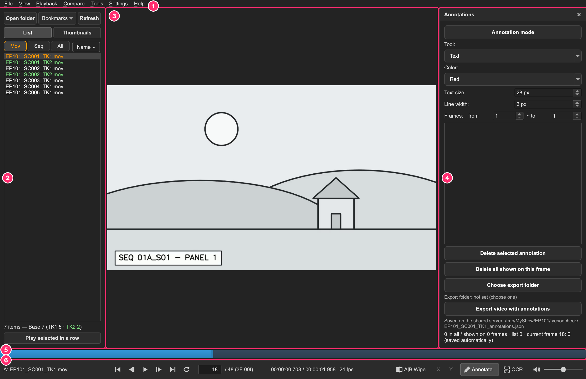
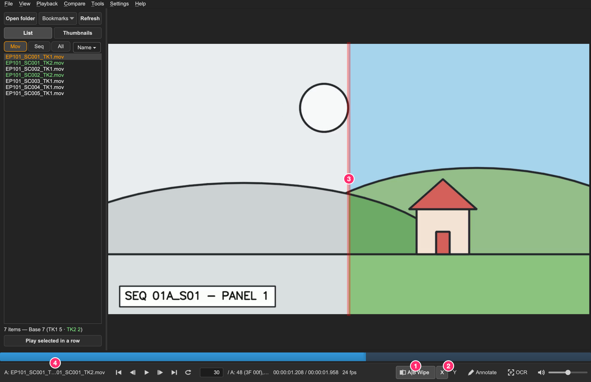
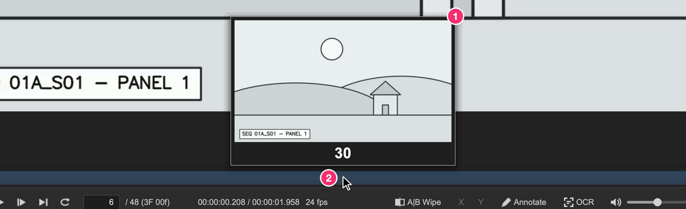
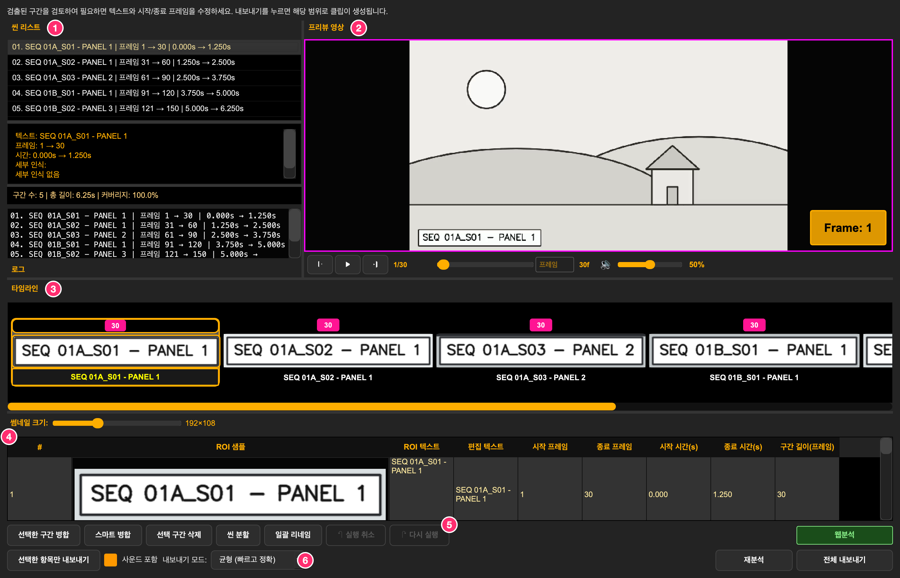

# YesonCheck

[한국어](README.md) | [English](README.en.md) | [Español](README.es.md) | **简体中文** | [日本語](README.ja.md)

YesonCheck 是一款用于审阅动画制作成果的视频播放器（PyQt5）。它在一个窗口中逐帧播放视频和图像序列，将两段视频叠在一起进行比较（A/B 划像），在帧上留下修改批注，并通过 OCR 和镜头切换检测把动态分镜（animatic）分成片段、导出为剪辑。支持 Mac（Intel 和 Apple Silicon）和 Windows，主窗口可以显示为韩语或英语。

## 截图
所有图片都使用合成视频和虚构的文件名拍摄。它们与应用内置使用手册中的图片相同，编号的含义在手册中有说明。

**主窗口** — 左侧边栏是视频列表，中间是视频，右侧是工具面板（修改批注），底部是播放栏

**A/B 划像** — 把两段视频叠在一起，移动分界线进行比较

**时间滑块预览** — 鼠标悬停在时间滑块上，即可看到该位置帧的画面和帧号

**OCR 审阅窗口** — 修正根据画面文字找到的片段，并导出为剪辑（此窗口以韩语显示）

## 主要功能
- **逐帧精确播放**视频和图像序列（tga、png、exr 等），播放栏始终在同一位置：跳到开头或结尾、前进或后退一帧、循环播放、输入帧号跳转
- **A/B 比较**，支持左右或上下划像 — 把鼠标移到列表的某一行并点击 **B**，即可在 B 中打开该视频并开启划像
- **修改批注**：在每一帧上添加文字和图形，自动保存，并可导出带有批注的视频
- **OCR 和镜头切换检测**（PySceneDetect、TransNetV2），把动态分镜分成片段 — 审阅、合并、拆分、重命名后导出剪辑
- **快速播放 ProRes**：Mac 使用系统解码器（VideoToolbox），Windows 使用随附的 ffmpeg
- **侧边栏**：带缩略图、排序、计数和书签的视频列表；时间滑块上的预览
- **更新**：有新版本时会显示提示条，点一下即可安装
- **界面语言**：在 Settings → 언어 (Language) 中选择韩语或英语 — 附属窗口和错误信息仍为韩语

## 下载与安装
从 [Releases](https://github.com/yesonsys03-web/yesoncheck/releases/latest) 下载最新版本：

| 电脑 | 文件 |
|---|---|
| Windows | `YesonCheck_Setup_<版本>.exe` |
| Mac（Apple Silicon） | `YesonCheck_Autocut_AppleSilicon_<版本>.dmg` |
| Mac（Intel） | `YesonCheck_Autocut_Intel_<版本>.dmg` |

- Mac 版需要 macOS 12.3 或更高版本。
- 在 Windows 上播放声音需要 [K-Lite Codec Pack](https://codecguide.com/download_kl.htm)（Basic 版即可）。没有它时能看到画面，但没有声音。

## 使用手册
在应用中选择 **Help → User guide (F1)**，会在浏览器中打开使用手册 — 按功能分页并配有图片，还包括键盘快捷键和更新记录，可切换韩语或英语。

## 开发者
从源码运行、构建以及代码结构，请参阅韩语的 [README](README.md) 和 [BUILD.md](BUILD.md)（均为韩语）。

## 许可证
YesonCheck 以 GNU 通用公共许可证第 3 版（**GPL-3.0**）发布 — 详见 [LICENSE](LICENSE)。随附的第三方组件的许可证和源码位置列在 [THIRD_PARTY_NOTICES.md](THIRD_PARTY_NOTICES.md) 中。
